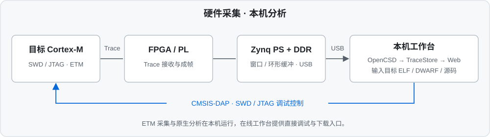
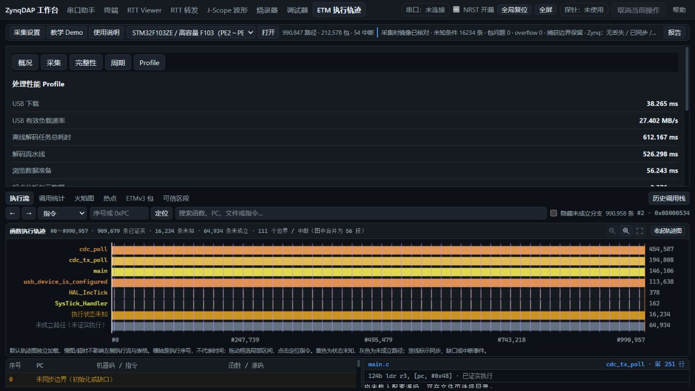

<div align="center">

# zynqlinkPRO

**基于 Zynq-7020 的 USB 调试与并行 ETM Trace 探针**

SWD / JTAG · RTT · 实时变量波形 · 固件烧录 · 源码调试 · ETM 执行轨迹


[**在线工作台**](https://minichao9901.github.io/zynqlinkPRO/) · [**工程下载**](https://minichao9901.github.io/zynqlinkPRO/#download) · [**Windows 完整包**](https://github.com/minichao9901/zynqlinkPRO/releases/latest/download/zynq-etm-bridge-win64.zip) · [发布记录](https://github.com/minichao9901/zynqlinkPRO/releases)

[功能总览](#功能总览) · [快速开始](#快速开始) · [ETM 执行轨迹](#etm-执行轨迹) · [实测性能](#实测性能) · [硬件与接线](#硬件与接线) · [开发与文档](#开发与文档)

</div>

---

zynqlinkPRO 将 FPGA 调试引擎、并行 Trace 采集和主机分析工具整合到同一套工作流：**PL 执行 SWD/JTAG 和 Trace 接收，PS 提供 USB 传输，Web 工作台完成连接、调试与数据浏览。** ETM 原生解码与建库在本机运行。

- **硬件调试引擎**：CMSIS-DAP v2，支持 SWD/JTAG、批量内存访问、RTT 转发与 HSS 变量采样。
- **独立 Trace 采集路径**：四位并行 ETM，FPGA 成帧、DDR 缓冲和 USB 采后下载，支持窗口采集与环形飞行记录。
- **一套主机工作台**：串口、波形、烧录、调试及执行轨迹共用界面；提供 Windows 便携包和 AI/脚本 CLI。
- **可复核的交付**：正式 bit/ELF、构建选项、SHA-256、板测报告与已知问题一同版本管理。

## 功能总览

| 工具 | 主要能力 | 使用方式 |
|---|---|---|
| 串口助手 / 终端 | HEX/文本收发、ANSI 终端、发送历史与记录 | 浏览器 Web Serial |
| RTT Viewer | 控制块发现、通道选择、目标 RAM 轮询与日志查看 | 浏览器连接探针 |
| RTT 转发 | 探针侧搬运 RTT 数据，经 USB/CDC 转发 | 浏览器 / 本机工具 |
| J-Scope 波形 | 多变量采样、曲线与泳道、游标、原始记录及 CSV | 浏览器连接探针 |
| 固件烧录 | 目标识别、BIN/HEX/ELF、写入校验；固件字节与 ELF 表查看 | 浏览器连接探针 |
| 调试器 | 断点、暂停/单步、寄存器、内存、源码及变量查看 | 浏览器连接探针 |
| ETM 执行轨迹 | ETMv3/v4 解码、源码回放、函数统计、火焰图及记录导入/导出 | **本机 Windows 工作台** |
| 工程下载 | 正式 Windows 完整包、版本说明及 SHA-256 | [在线下载页](https://minichao9901.github.io/zynqlinkPRO/#download) |

具体芯片、事务与验证范围见[项目能力评估](docs/validation/project-assessment-20261104/README.md)和[验收索引](docs/validation/README.md)。界面具备某项入口不代表所有目标芯片组合均已通过实板验收。

## 快速开始

### 使用 ETM 工作台

1. [下载 Windows x64 完整包](https://github.com/minichao9901/zynqlinkPRO/releases/latest/download/zynq-etm-bridge-win64.zip)，**完整解压**并保留 `_internal` 目录。
2. 双击 `zynq-etm-bridge.exe`，浏览器自动打开本地工作台；无需另装 Python 或 Node.js。
3. 接好探针与目标，载入**与目标 Flash 内容一致的 ELF**及源码，选择函数起点，核对目标时钟，再进行采集。

没有目标板也可先使用 ETM 页的离线教学示例，或导入已有记录。更新前退出旧程序，保留 `data` 目录中的个人记录。本机开发目录的固定程序入口为 `dist/zynq-etm-bridge/zynq-etm-bridge.exe`。

### 使用在线调试工具

打开[在线工作台](https://minichao9901.github.io/zynqlinkPRO/)，使用桌面版 Chrome / Edge，进入所需工具并点击连接、选择 USB 或串口设备。在线站点提供静态前端；**ETM 采集和解码使用本地 EXE 服务**。

探针固件已提供 WebUSB 网页入口描述符，指向本项目的工程下载页。插入后的通知显示与 USB 授权由浏览器控制。

## ETM 执行轨迹



- **协议与目标**：保留 F103ZE ETMv3 和 STM32H743 ETMv4，TPIU 解复用后由 OpenCSD 解码。
- **源码级分析**：指令与源码映射、执行流查询、函数统计、源码回放和报告导出；ETMv4 周期统计取决于目标配置及记录中实际存在的周期信息。
- **交互式导出**：自包含 HTML 火焰图支持时间线、周期视图、框选放大和查找，导出后可独立打开。
- **飞行记录**：F103ZE 支持 DDR 环形缓冲，手动触发或主机 Fault 轮询触发；覆盖区间、未知起点和恢复结果显式记录。
- **离线使用**：无需连接硬件即可导入记录、查询执行流与导出报告。

<div align="center">

</div>

操作见 [ETM 使用说明](docs/Zynq-ETM-Trace操作说明.md)、[Trace CLI](docs/Trace-CLI使用说明.md)、[飞行记录](docs/validation/session-flight-recorder-20261105/README.md)及 [HTML 导出](docs/flame-html-export.md)。

## 实测性能

以下为**指定配对、目标和测试条件**下的实测，不将链路时钟、采集吞吐或离线处理时间当成完整 Web 端到端速度。MB/s 按十进制计。

| 指标 | 已验证结果 | 条件与证据 |
|---|---|---|
| SWD SRAM 读 / 写 | **4.817 / 4.733 MB/s** | J7 ELD1 bit，F103ZE CPU48 MHz，实际 SWCLK约60 MHz；2 KiB块、depth32、三轮及10秒校验，[报告](docs/validation/j7-sequence-fix-20261106/README.md) |
| JTAG SRAM 读 / 写 | **2.418 / 2.395 MB/s** | 同目标、同规模，实际TCK约60 MHz，[报告](docs/validation/j7-sequence-fix-20261106/README.md) |
| ETM Trace 时钟 | **24 MHz基线；32 MHz限定验证** | ELD1默认零tap，24 MHz三轮100 ms、32 MHz三轮1 s采集/解码通过，[报告](docs/validation/j7-sequence-fix-20261106/README.md) |
| DDR → USB采后下载 | **约38.7 MB/s** | 历史J7配对、相同SRAM负载、100 MiB窗口，24/32 MHz交替三轮，[报告](docs/validation/j7-traceclk-20261106/README.md) |
| 缓冲与窗口 | **100 MiB DDR；普通窗口CLI上限2 s** | F103ZE 24 MHz三轮2 s与环形覆盖/下载通过；环形持续时间由数据率决定，[报告](docs/validation/j7-adapter-limits-20261106/README.md) |

当前交付固件的 SWD/JTAG 上限为60 MHz。66.667 MHz SWD 属于独立实验，未作为正式固件档位；36 MHz Trace 的校准候选裕量仍不足。较长/较大记录可能触及查询索引容量（ZL-157），32 MHz不等于所有2 s记录均可完成建库。[同口径性能对照与瓶颈](docs/validation/j7-traceclk-20261106/README.md) · [问题索引](docs/项目问题跟踪列表.md)。

## 硬件与接线

当前适配 **XC7Z020-CLG400 / J7转接板**。SWD/JTAG与四位Trace共用一块转接板；J7约束为LVCMOS33，连接前核对目标I/O电平并共地。

| 信号 | 相对FPGA方向 | J7脚 | FPGA球号 |
|---|---|---:|---|
| TMS / SWDIO | JTAG输出 / SWD双向 | 31 | L16 |
| TCK / SWCLK | 输出 | 29 | L15 |
| TDO | 输入 | 27 | L14 |
| TDI | 输出 | 25 | M15 |
| nSRST | 输出 | 23 | M14 |
| nTRST | 输出 | 19 | N15 |
| RTCK | 输入预留 | 15 | H15 |
| TRACECLK | 输入 | 41 | J16 |
| TRACED0 | 输入 | 39 | K16 |
| TRACED1 | 输入 | 37 | M18 |
| TRACED2 | 输入 | 35 | M17 |
| TRACED3 | 输入 | 33 | L17 |

Trace五路输入包含ELD1延时单元，默认零tap。RTCK自适应、断开后TCK高阻（ZL-159）及外部I/O完整时序签核（ZL-007）仍有明确边界，详见[接线与实现复核](docs/validation/j7-eld1-20261106/j7-production-audit.md)。

### 正式固件

| 产物 | 说明 |
|---|---|
| [J7 release-20261106](prebuilt/release-20261106/README.md) | 当前bit/ELF：ELD1、原始SWD序列修复、WebUSB网页入口；F103ZE限定验收 |
| [J7 QSPI启动包](prebuilt/qspi-release-20261106/README.md) | 同一bit/ELF的固化版本，整片回读、范围外比较、实体冷启动及F103ZE回归通过 |
| [Golden](prebuilt/golden/README.md) | 原已验证比较与回退配对 |
| [QSPI恢复包](prebuilt/recovery/README.md) | 已验收的历史恢复镜像，身份和适用范围独立记录 |
| [目标固件](prebuilt/README.md) | F103ZE/H743等目标ELF及来源 |

加载与固化必须使用同一manifest声明的bit/ELF。JTAG/RAM加载不会自动写入QSPI；当前QSPI固化状态见[正式产物索引](prebuilt/README.md)。

## 开发与文档

| 路径 | 内容 |
|---|---|
| `fpga/` | PL RTL、约束、仿真与实现 |
| `firmware/` | Zynq PS固件、QSPI启动链与目标MCU例程 |
| `web/` | 在线与本机共用的工作台前端 |
| `etm-service/` | 采集服务、OpenCSD/C++原生处理及TraceStore |
| `tools/`、`toolbox.py` | 构建、加载、烧录、诊断及统一CLI |
| `prebuilt/` | 正式bit/ELF、恢复包和目标固件 |
| `docs/` | 操作手册、验收、问题索引和归档导航 |

```powershell
# 发现当前可用工具，不操作板卡
python -X utf8 toolbox.py project list
python -X utf8 toolbox.py trace doctor --offline

# 主机检查与Windows完整包构建
python -X utf8 toolbox.py project run web.check
python -X utf8 toolbox.py bridge-build --zip
```

开发接手先读 [AGENTS.md](AGENTS.md)、[CLI工作台](docs/toolbox-cli-ai.md)和[依赖说明](docs/dependencies.md)。其余文档从[文档导航](docs/README.md)进入，发现和修复问题同步更新[项目问题跟踪列表](docs/项目问题跟踪列表.md)。

业务Trace保留[5份精选记录](docs/retained-records.json)，自动测试保留必要固定输入。旧实验和逐轮输出通过[归档索引](docs/validation/README.md)恢复。第三方组件及许可证保留在对应vendor目录，Windows包另附`licenses/`；网页与程序发布方式见[GitHub发布](docs/github-release.md)。
