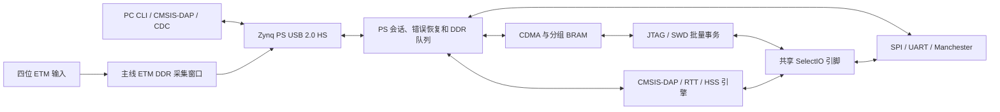

# J7 SelectIO 多协议探针 CLI

这套固件在同一块 Zynq-7020 上提供 CMSIS-DAP、RTT、变量采样、四线 SPI、串口、SWO 和四位并行 ETM。以下命令在本工作树根目录运行。带有输出路径的命令使用新文件。示例目标是 STM32F103ZE CDC48，目标 HCLK 为 48 MHz。固定配对和构建身份见[产物清单](../../prebuilt/selectio-j7-fusion/manifest.json)。Windows 主机依赖、Vivado/SDK 和 OpenOCD 的安装位置见[依赖说明](../dependencies.md)。标准串口示例需要 pyserial，验收脚本另用 NumPy 校验连续样本。

## 架构和引脚

PS 负责 USB、会话、DMA、错误恢复和 RTT/变量并发调度。PL 的固定事务引擎负责 TAP 状态转换、APACC、SWD 换向、ACK、批量传输、串行编解码和采样。主机可以提交有限长度的事务描述符，PS 可以重用并修补描述符。逐边沿时序由 SelectIO 产生。这个实现不需要通用微码解释器。ETM 延用主线的独立采集时钟、DDR 窗口、USB 下载及离线解码。



高速内存路径在 GP1 配置队列，CDMA 对每种协议的四个 TX/RX bank 搬运数据。标准 DAP、独立 RTT 和独立变量采样复用实时 AP 事务通道；并发采集由 PS 在单次 AP 会话内安排采样和有界的 RTT 读取。串口接收的 FPGA 环有 64 KiB，PS 在前台转入 2 MiB DDR。完整 SWO 缓冲容量以 IF0 的 DAP_Info 或 IF4 的 info 为准。

| J7 针号 | Zynq 球位 | 调试 | SPI 主机 | 串行 |
|---|---|---|---|---|
| 29 | L15 | TCK / SWCLK | SCK | — |
| 31 | L16 | TMS / SWDIO | CS，低有效 | — |
| 25 | M15 | TDI | MOSI | 探针 TX，接目标 RX |
| 27 | L14 | TDO | MISO | 探针 RX，接目标 UART TX / CoreSight SWO |
| 41、39、37、35、33 | J16、K16、M18、M17、L17 | TRACECLK、TRACED[0..3] | — | ETM |

J7 信号使用 LVCMOS33，探针与目标共地。nSRST 在 J7-23，nTRST 在 J7-19。SWD 的时钟和数据只需 L15、L16，可与使用 L14 的被动监听共存。[J7 转接板引脚](../validation/j7-adapter-20261106/README.md)

JTAG 占用 TDI/TDO，SPI 切换时取得四根线的独占权。F103 的 PB3 可切换 JTDO 与 TRACESWO，PA15 用作 JTDI 或测试目标的串口接收。目标串口、ITM 和四位 ETM 各自需要正确的目标引脚配置。

## USB 接口分配

同一 VID/PID 及序列号下保留现有 CMSIS-DAP、CDC 和控制 HID，另设一个厂商专用 WinUSB 接口。PC 读取序列号选择设备，COM 号由 Windows 分配。

| 接口 | 端点（十六进制） | CLI 用途 |
|---|---|---|
| IF0，CMSIS-DAP v2 | 02 OUT、81 IN；87 IN；82 IN | 标准调试；原有 HSS 数据；ETM 下载 |
| IF1/2，CDC ACM | 85 通知、04 OUT、83 IN | 物理 8N1 串口，可显式切换为兼容 RTT 转发 |
| IF3，HID | 06 OUT、86 IN | 主线探针控制与状态 |
| IF4，WinUSB，FF/53/01 | 01 OUT、84 IN | 高速 SRAM、RTT、变量、SPI、UART/SWO 和并发流 |

历史 RTT 上行可走 CDC。历史变量波形走专用 EP87，载荷是 HSS 帧。现在 RTT 和变量使用 IF4 的独立通道和队列。先绑定物理 CDC 并打开终端，再启动 SWD 的原生 RTT/变量采样；实板已同时核对这三个通道。当前配置的 IN 端点 1–7 均有用途；在 IF4 的 Bulk 对上按通道号分流，使 RTT、采样和其他原生数据共用带宽，每类数据仍有自己的消费指针。协议头包含长度、序号和状态；消费指针在对应 IN 完成后推进。内存读写可设队列深度 1–4。物理 SWO 可走 IF4，也可走标准 CMSIS-DAP 的 SWO_Transport=1、SWO_Data 轮询。固件声明 UART 与 Manchester 能力、接收缓冲容量和测试域时间戳。EP87 继续给 HSS 使用。[描述符与协议](../selectio-native.md)

## 识别、临时加载及调试

按本分支验收记录中的 manifest 选择相配的 bit、Zynq ELF、PS 初始化 Tcl。加载命令在写入探针易失配置前检查占用，在加载后核对 OCM。目标 MCU ELF 与探针 ELF 分开传入。

```powershell
$pair = 'prebuilt/selectio-j7-fusion'
python -X utf8 toolbox.py probe-load --selectio --dry-run
python -X utf8 toolbox.py probe-load --selectio --out build/my-load
python -X utf8 toolbox.py selectio --serial 12345678 info
python -X utf8 toolbox.py selectio usb-test --seconds 60
python -X utf8 toolbox.py selectio --help
```

info 同时显示实际枚举的五个接口、各端点、PS 固件 ABI、队列深度、原生块头大小和 PL 特性字。link_hz 是由真实参考寄存器换算的高速模式线速。兼容 DAP 使用不超过 10 MHz 的初始化档，显式请求 100 MHz 切换到专用 PHY。

下例的时隙值用于通过验证的特定版次。更换 bit 后按对应 manifest 选择 slot。tap 是输入 IDELAY 档位，slot 单位为 2.5 ns 的 DDR 时隙，idle 是事务间的空闲周期。F103 上电后的应用可能关闭完整 JTAG，使用 JTAG 前须确认目标的 AFIO 配置。示例先在 1 MHz 识别，再切到 100 MHz。在一个终端启动 OpenOCD，在第二个终端运行 GDB。退出 GDB 可用 `detach`。

```powershell
$transport = 'swd'
$tap = 8
$slot = 24
$idle = 2
# JTAG 对应参数
# $transport = 'jtag'; $tap = 16; $slot = 28; $idle = 33
python -X utf8 toolbox.py selectio profile --transport $transport --tap $tap --slot $slot --idle $idle
python -X utf8 toolbox.py selectio identify --transport $transport --clock 1000000
openocd -f interface/cmsis-dap.cfg -c "adapter serial 12345678" -c "transport select $transport" -f target/stm32f1x.cfg -c "adapter speed 1000" -c "init" -c "adapter speed 100000"
arm-none-eabi-gdb prebuilt/golden/f103ze-cdc48.elf -ex "target extended-remote localhost:3333"
```

CDC48 应用在启动时设置 SWJ_NOJTAG。可以在已核对该目标映像后，用仓库的 F103 JTAG 夹具临时开启完整 TAP，命令结束后恢复原应用的 SWJ 设置。数字 2 来自该固件源码。

```powershell
python -X utf8 tools/run_f103_jtag_fixture.py --serial 12345678 --swd-khz 1000 --run-during-child --restore-swj 2 --output build/jtag-identify-state.json -- python -X utf8 toolbox.py selectio identify --transport jtag --clock 100000000
```

运行独占的原生会话前退出占用接口的调试服务器。以下用 PowerShell 数组传递吞吐参数。读写地址和长度按 4 B 对齐，原生优化窗口为 F103 的 64 KiB SRAM。写示例把刚读出的文件写回，执行前确认区域由调用方独占。主机深度和 1 KiB TAR 分割由 CLI 管理。

```powershell
$link = @('--transport', $transport, '--tap', $tap, '--slot', $slot, '--idle', $idle)
$bulkIdle = if ($transport -eq 'jtag') { 29 } else { 2 }
$bulkLink = @('--transport', $transport, '--tap', $tap, '--slot', $slot, '--idle', $bulkIdle)
python -X utf8 toolbox.py selectio read @bulkLink --address 0x20008020 --bytes 4032 --out page.bin --queue-depth 4
python -X utf8 toolbox.py selectio write @bulkLink --address 0x20008020 --file page.bin --queue-depth 4
```

## RTT 和 J-Scope

双频效率候选在内存读写、RTT 和变量采样入口接受 `--clock 50000000` 与 `--clock 100000000`。下列 A/B 命令使用候选 bit/ELF，F103ZE 保持 CDC48。50 MHz 示例的采样相位仍待用实板校准。每次测试使用新的输出目录。

```powershell
# 以同一 SRAM 帧格式读写探针私有 DDR，逐项测纯 USB、队列深度和传输方向
python -X utf8 tools/selectio_transport_bench.py --serial 12345678 --seconds 10 --schedule sliding --out build/usb-sliding
python -X utf8 tools/selectio_transport_bench.py --serial 12345678 --seconds 10 --schedule grouped --out build/usb-grouped

# 真实目标 SRAM，先备份 16 KiB，分别计读、写、混合，最后恢复目标
python -X utf8 tools/selectio_f103_fixture.py --serial 12345678 --size 16384 --out build/swd50-state --execute -- python -X utf8 tools/selectio_pipeline_bench.py --transport swd --clock 50000000 --tap 8 --slot 16 --idle 0 --frame 16384 --bytes 16320 --depth 4 --seconds 60 --rounds 3 --out build/swd50-pc --execute
```

统一板卡入口支持按所选配对的 50 / 100 MHz 参数串行运行实际调试、内存、RTT、变量采样及 USB 对照。下例先打印计划；添加 `--execute` 后经 HS3 临时加载对应 bit/ELF、检查身份、备份目标 SRAM，然后逐项测试并复核恢复。每个 SRAM 窗口的复算例见效率报告。

```powershell
python -X utf8 toolbox.py project run board.accept -- --selectio --board f103ze --pair prebuilt/selectio-efficiency --clock 50000000 --frame 16384 --only switch --only debug --only memory --only rtt --only scope --only combo --only usb-ddr
```

运行态 RTT 默认使用与 100 MHz 历史成绩相同的 1,024 B 目标环。给同一入口加 `--rtt-ring-bytes 8192` 可测大环并减少环尾截断。两种容量使用同一个 Cortex-M3 生产者，每次运行都从真实 RTT 描述符取环地址和大小。大环占用的区域由 16 KiB SRAM 夹具备份和复原。请分别保存两次的报告，以便区分环长和 USB 帧长带来的变化。

F103ZE HCLK128 的 50 MHz SWD 优化包见 [候选配对](../../prebuilt/selectio-swd50/README.md)。在已经加载该配对、目标 RTT 控制块和上行环均位于 SRAM 的条件下，可使用 `rtt-queue` 启动专用队列路径。它连续读完整 TAR 页，每次最多 4 KiB，并在落入探针 DDR 后检查 RdOff 写入的 SWD 应答和 DP 状态。以下地址是本仓库 SRAM 夹具的示例。

标准 CMSIS-DAP 与 RTT→CDC 共用 50 MHz SWD 批次队列的验证配对是 [selectio-swd50-standard](../../prebuilt/selectio-swd50-standard/README.md)。CMSIS-DAP 使用现有 TransferBlock 命令。CDC 转发继续使用 J7 串口，启动后借用同一队列，并在 STOP 或调试器接管时交还 AP。[实测与复测入口](../validation/swd50-standard-20261122/README.md)

```powershell
python -X utf8 toolbox.py selectio --serial 12345678 rtt-queue --tap 8 --slot 22 --idle 0 --address 0x20008200 --seconds 60 --out build/rtt-queue.bin
python -X utf8 tools/selectio_f103_clock_accept.py --pair prebuilt/selectio-swd50 --hclk-mhz 128 --only memory --only rtt --rtt-queue --memory-page-aligned --seconds 60 --rounds 3 --out build/swd50-accept --execute
```

独立 RTT 的 `--chunk 1024` 或 `--chunk 2048` 控制每次确认目标 RdOff 之前最多搬运多少字节。CLI 默认在协商到 16 KiB 的 IF4 上使用 2,048 B，旧接口沿用 1,024 B。STOP 返回的状态字给出实际设置。统一验收入口的对应参数是 `--rtt-chunk`，例如固定 `--only rtt --clock 50000000 --rtt-ring-bytes 8192`，分别用两个块长运行。报告中的 `stream_MBps` 使用从服务启动确认到 STOP 尾部排空的窗口，`cli_process_MBps` 包含启动 CLI、连接与退出耗时，二者均使用已验证的主机有效字节。

在相同线速做小帧对照时，用 `--frame 4096 --bytes 4032`；比较队列策略用相同帧长、字节数和深度，仅调整 `--schedule`。报告中的 `clock` 给出时钟树、队列分频及采样 tap 的来源。`wall_MBps` 包含主机载荷生成和校验，`probe` 中的计时覆盖队列与 PS 块函数。[分层基线和数字模型](../validation/efficiency-20261122/README.md)

以下地址仅作 CDC48 示例；其他固件从目标 ELF 符号表取得 RTT 控制块或变量地址。RTT 下行需要目标定义 DOWN 通道。本项目的 J-Scope 指主线 HSS 硬件变量采样，CLI 可导出 CSV。独立采样支持 1–8 个变量。周期单位为 24 MHz tick，`24000` 表示 1 ms。`--var` 的格式为地址、字节宽度、类型码，用冒号分隔。类型码 0–7 依次对应 u8、i8、u16、i16、u32、i32、f32、f64。

```powershell
python -X utf8 toolbox.py selectio rtt --transport $transport --clock 100000000 --address 0x2000b000 --size 256 --channel 0 --seconds 10 --out log.rtt
python -X utf8 toolbox.py selectio rtt-send @link --address 0x2000b000 --channel 0 --text "help`n"
python -X utf8 toolbox.py selectio rtt-terminal @link --address 0x2000b000 --channel 0 --up-channel 0
python -X utf8 toolbox.py selectio scope --transport $transport --clock 100000000 --var 0x2000c000:4:4 --var 0x2000c004:4:4 --period 24000 --seconds 10 --out scope.hss
python -X utf8 toolbox.py selectio scope-export --in scope.hss --csv scope.csv
python -X utf8 toolbox.py selectio combo @link --rtt-address 0x2000b000 --channel 0 --var 0x2000c000 --var 0x2000c004 --ticks 24000 --seconds 60 --rtt-out combined.rtt --scope-out combined.csv
```

`combo` 在一个 AP 会话内同时取得 RTT UP 字节及 1–8 个对齐的 u32 变量，分别输出原始字节与带时间戳的 CSV。终端支持双向输入输出。独立采样的二进制记录可通过 `scope-export` 检查定义、帧序号、样本数、跳拍数和结束状态。100 MHz 是 SWCLK/TCK 线速；采样率取决于变量数量、地址布局和目标响应。

## 物理串口、SWO 和 SPI

`com bind` 将 CDC 分配给物理 UART，打开 Windows 串口并置 DTR 后开始工作。配置为 8N1，波特率由 CDC SET_LINE_CODING 提交。串口号可以用 `python -m serial.tools.list_ports -v` 按 USB 序列号查找。单独运行 `uart` 可以用文件或十六进制载荷发送并保存收到的原始字节。

```powershell
python -X utf8 toolbox.py selectio com bind
python -X utf8 toolbox.py selectio com status
python -m serial.tools.miniterm COM43 115200
python -X utf8 toolbox.py selectio com release
python -X utf8 toolbox.py selectio uart --rate 115200 --hex 550d0a --seconds 2 --out uart.bin
python -X utf8 toolbox.py selectio swo --encoding uart --rate 48000000 --configure-f103 --itm-mask 1 --seconds 2 --out itm-uart.bin
python -X utf8 toolbox.py selectio swo --encoding manchester --rate 24000000 --configure-f103 --seconds 2 --out itm-manchester.bin
python -X utf8 toolbox.py selectio swo --usb-path cmsis-dap --encoding uart --rate 48000000 --configure-f103 --seconds 2 --out standard-swo.bin
python -X utf8 toolbox.py selectio swo --encoding manchester --rate 100000000 --seconds 2 --out external-manchester.bin
python -X utf8 toolbox.py selectio spi --mode 0 --slot 22 --tap 0 --hex 9f000000 --out spi-rx.bin
```

关闭串口终端后执行 release。F103 配置选项会保存并恢复 TPIU、ITM 和相关 GPIO 配置，要求该目标的实际 HCLK 和 TPIU 分频可产生请求码率。目标需要主动写 ITM 激励端口才会产生有效包。已配置的外部源可直接被动接收。Manchester 的 rate 表示信息位率，100 Mbit/s 对应 200 Msymbol/s。原生 Manchester 100 Mbit/s 可用 `--tap 0..31` 和 `--phase 0|1` 调整接收采样位置。SPI 固定 100 MHz、MSB first、模式 0–3，由一次命令在同一次 CS 低电平下交换 1–4,079 B，文件发送可用 `--file`。

## ETM

```powershell
python -X utf8 toolbox.py trace doctor --offline
python -X utf8 toolbox.py trace capture --elf prebuilt/golden/f103ze-cdc48.elf --bit "$pair/probe.bit" --zynq-elf "$pair/application.elf" --swd-khz 10000 --seconds 1 --out build/my-etm --json-out build/my-etm.json
python -X utf8 toolbox.py trace query --record build/my-etm --view summary
python -X utf8 toolbox.py trace capture --running-window --elf prebuilt/golden/f103ze-cdc48.elf --bit "$pair/probe.bit" --zynq-elf "$pair/application.elf" --swd-khz 10000 --seconds 1 --out build/my-etm-running
python -X utf8 toolbox.py trace verify --record build/my-etm-running --require-decoded
```

F103 保持 CDC48 时 TRACECLK 为 24 MHz。默认窗口从目标恢复执行开始，记录起点可同时出现初始化未同步和调试重启标记。需要观察已经运行的程序时，加 `--running-window`，在 ETM 源恢复输出后再启动完整的硬件计时窗口。入口断点模式用 `--entry` 另行选择。按采集 JSON 核对实际 SWD 配置频率、窗口长度、frameDrops、parserErrors、USB 完成状态、解码 gap 与目标恢复。进一步的导出及符号查询见 [Trace CLI](../Trace-CLI使用说明.md)。

空闲原生 SRAM 会话的释放时限为 2 秒；主机没有继续取流时，原生 AUX、RTT 和 HSS 经过 5 秒释放其私有资源。新主机的 HELLO 按序号识别并排空旧回复。标准 DAP SWO 由 SWO_Control 与 DAP_Disconnect 控制，CDC 由串口 DTR 控制。

## 构建与复测

融合版三档调试时钟、SRAM、采集和物理接口的定向性能验收见 [精简性能用例](fusion-performance-cases.md)。

```powershell
$env:ZYNQLINK_FPGA_OUT = "$PWD/build/selectio"
python -X utf8 tools/run_vivado.py -mode batch -nojournal -source fpga/build_dma.tcl -tclargs --selectio
python -X utf8 tools/build_xusbps_daplink.py --selectio --j7-adapter --compact-code --max-swclk-hz 10000000 --timing build/selectio/verified_clock.json --out build/selectio-ps
python -X utf8 tools/selectio_cm3.py
python -X utf8 tools/selectio_cm3.py --services --sample-ticks 64 --out build/cm3-jtag-services
python -X utf8 tools/selectio_cm3.py --services --swd-only --sample-ticks 32 --out build/cm3-swd-services
python -X utf8 toolbox.py project run board.accept -- --selectio --board f103ze
python -X utf8 toolbox.py project run board.accept -- --selectio --board f103ze --pair $pair --out build/accept-new --execute
python -X utf8 toolbox.py project run board.accept -- --selectio --review build/accept-new/summary.json
```

PS 构建参数中的 10 MHz 约束兼容初始化速率。100 MHz 模式使用独立的 SelectIO 参考时钟。对有写入的实板压力测试，`selectio_f103_fixture.py` 会核对目标映像、保存 4 KiB SRAM、两侧哨兵及初始运行状态，并在独立进程中读回恢复结果。下列示例仅用于该 F103 实验夹具。

```powershell
python -X utf8 tools/selectio_f103_fixture.py --out build/my-guard --execute -- python -X utf8 tools/selectio_pipeline_bench.py @link --bytes 4032 --depth 4 --seconds 60 --rounds 3 --out build/my-pipeline --execute
```

各配对的时序、真实目标读写、序列校验和恢复数据分别归档在[板测报告](../validation/selectio-integration/README.md)。与商用探针对照时，分别比较目标 RAM 写入 MB/s、目标运行时 RTT MB/s、变量采样组/s 和物理 SWO 信息位率。公开参照值包括 J-Trace PRO 的 4.0 MB/s RAM 下载、SEGGER 所列约 3.5 MB/s RTT 背景传输，以及 ULINKpro 的 100 Mbit/s Manchester。测试目标与传输方式会影响结果。[SEGGER J-Trace](https://www.segger.com/products/debug-probes/j-trace/) · [SEGGER RTT](https://kb.segger.com/General_information_about_RTT) · [Arm ULINKpro](https://support.arm.com/tools-and-software/ulinkpro)
