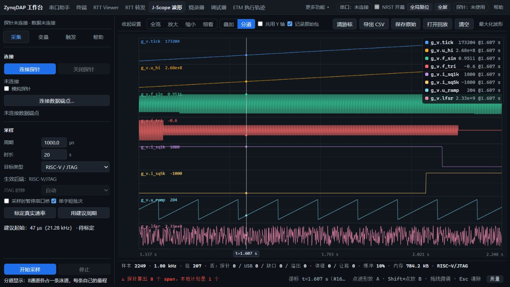

# HPM6800EVK 缺首DEF与CDC字节缺口：定位、修复及冻结EXE验收

2026-11-02，用户明确要求继续修复，恢复ZL-005的定位；原暂停记录[R4](../combined-etm-web-20261031/deferred-hss/issue.json)、[R22](../hpm6800-web-stress-20261102/README.md)保持历史原文。**本轮HPM复现链ZL-005、ZL-094已修复并完成对照与回归**。两个根因都不在RTL：前者是PS USB标准请求处理，后者是本机COM读取方式。ZL-070临界HSS波动、ZL-093性能差距及新发现ZL-097的span元数据警告、ZL-098的原生→Web初连超时分别保留，未宣称全平台、任意负载全通过。

## 配对与执行范围

实际加载并最终留板配对：[prebuilt/hpm6800-usb-fixed-133-20261102](../../../prebuilt/hpm6800-usb-fixed-133-20261102/README.md)。bit SHA256 `106d579bc1b79c2b873fd1e3eb2609d468892a67613d85a6e41d4dc90c8fc177`，Zynq ELF `e93f1810d48e77f8d9aa097f643e40e0aaee32bdec1c263c1428f092909e608a`。PL复用133.333333MHz/7.5ns已验证bit（setup+0.179ns、hold+0.034ns），未改RTL、未重新路由；新PS只修改Chapter9的CLEAR_FEATURE分支，O3/Thumb compact、cap66666666Hz，未启用zero-idle或fixed-SWD。完整构建选项、源文件哈希在ps-build.json；最终物理MEM-AP0核对**76420B**可执行代码匹配。

旧PS对照为[R22](../hpm6800-web-stress-20261102/README.md)的e1bf65a6…，bit相同。新PS先修DEF，CDC仍能复现；随后CDC修复前后使用**同一新PS、同一RAM靶子与时钟**，没有用重载、MCU复位、Flash替换或降频制造通过。最终冻结EXE则按用户实际路径验收，非模拟探针。

## ZL-005：清HALT时漏掉DATA0复位

Web连接HSS数据端点时执行clear-halt。原PS的CLEAR_FEATURE(ENDPOINT_HALT)只清TXS/RXS，没有设置TXR/RXR。主机重置数据切换状态，而设备未同步，首个512B包被当作重复PID处理，恰好是DEF。不是页面没显示，也不是需要给页面补一个假DEF。

[USB2.0标准9.4.5](https://bitsavers.trailing-edge.com/components/usb/USB_2.0_2000.pdf)要求该请求重建DATA0，即使HALT本来未置位；[Xilinx示例](https://github.com/Xilinx/embeddedsw/blob/master/XilinxProcessorIPLib/drivers/usbps/examples/xusbps_ch9.c)可作为该旧分支来源对照。修正保持原请求/ACK流程，IN清STALL后设置TXR、OUT设置RXR，不重置整个USB或目标。

|同板对照|轮数|结果|
|---|---:|---|
|旧PS，不clear-halt|10|全部DEF seq0起|
|旧PS，clear-halt|10|全部缺DEF，DATA seq1起，少512B|
|新PS，交替有/无clear-halt|100|100/100有DEF seq0|
|最终新EXE随机切换及1/3/8通道|24步中的6次Scope，另3个独立窗口|每轮真实DEF、RAW/CSV/探针最终计数、已知波形均匹配|

最小对照只读有效AXI SRAM，目标保持运行，未写SRAM/Flash或复位MCU；每轮先确认端点静默，无旧包。100轮不是换低速掩盖问题，前后均为约10MHz、idle8。单测执行生产Chapter9分支，覆盖IN/OUT、已/未STALL及保留另一方向状态。没有启用历史未验收readEpoch补丁，也没靠1.5秒本地DEF fallback销案。旧Golden文件保留原字节，需使用本轮对应PS配对。

## ZL-094：COM小读/HTTP节奏导致带负载URB被取消

新PS复跑原seed680020261102的8步，Scope均通过，但第7步CDC仍出现真实内容不连续。Windows ClearCommError标志为0，说明错误计数不能证明无损。继续采用可逐字节推导的递增little-endian u32流，模拟4/13/127/2048B发布粒度；AXI版本复刻原靶子的CB0x01240000、pBuffer0x012400b8、32KiB环，并保持该区域原有非缓存PMA。

USBPcap仅过滤探针（当时USBPcap3、地址8），不捕获键鼠/摄像头。PyUSB bus编号不能直接当USBPcap根集线器编号，实际通过extcap设备树核对。格式和完成状态按[USBPcap说明](https://desowin.org/usbpcap/captureformat.html)解析，按IN提交顺序归并；`0xC0010000`是[CANCELED兼容定义](https://raw.githubusercontent.com/libusb/libusb/master/libusb/os/windows_common.h)。未把USBPcap当作物理总线PID分析仪，其[URB级限制](https://desowin.org/usbpcap/capture_limitations.html)仍适用。

|对照|USB完成记录中全部负载B|其中被取消URB的负载B|COM/HTTP/Web实际B|完整序号|
|---|---:|---:|---:|---|
|旧主机，同布局AXI四轮合计|15634342|4096（两笔各2048）|15630246|USB全部负载连续；Web缺两段|
|旧主机，HTTP返回延迟50ms|849914|32256|817658|失败|
|新主机，相同50ms延迟|1851382|0|1851382|逐字节一致|

两组旧主机中，**从USB记录移除全部CANCELED负载，所得字节流与Web文件完全相同，SHA也相同**；未取消部分无额外差异。COM读取与HTTP返回的字节数/CRC一致且无并发物理读，定位到COM消费之前/之中，而不是HTTP序列重放或页面Blob拼接。修后仍可有关闭时0B取消，这与带有效数据的取消不是一回事。

旧代码由每个HTTP请求执行`read(1)`，再按`in_waiting`取数。读取节奏依赖浏览器/HTTP，有空档且不断更换小COM读取请求。修正为**独立线程持续64KiB读**，HTTP只取已收到的有界队列。4MiB上限不静默覆盖旧数据；超限/物理读错明确失败，浏览器错误流退出并清理。关闭时取消并join旧读线程，确认退出后才关闭/复用端口。未改变CDC波特率、目标时钟、RTT数据或PL协议。

已证明本机该读取架构触发/移除了带负载取消窗口；没有进一步给Windows驱动内部的具体取消例程下结论，也没声称其他OS/Chrome直接Web Serial必然同因。

## 完整性与功能验收

* 修正观测器后，HTTP延迟150ms，4/13/127/2048B发布的四轮分别收到3366908、3403764、3176397、3147776B，全部与目标STOP ACK后的发布量及序号逐字节一致。
* **最终实际冻结EXE**完整窗口：13/2048B发布分别收到5869565、5885952B，两轮均从序号0开始，发布/探针移动/窗口文件总量一致；包括整记录丢失、部分字节、重复和顺序都检查，非重复hello文本或只看计数器0。此前版本5847036/5853184B通过的记录仍保留。
* 新EXE固定seed的24步随机为**24/24通过**、22次实际Web镜像切换，耗时约15.9分钟，无清理错误。覆盖活动RTT Viewer、CDC、Scope、调试的交接，镜像均真实擦写、逐字节校验、复位，默认烧录10MHz。
* 原失败的第7步已通过；调试同时核对GPR/SRAM恢复、真实单步cause/step位、8个触发器及第9个拒绝、参数/回溯/位域、源码跳过/跳出与返回值。没有把未执行的CLI投递当业务完成。
* 独立1/3/8通道1kHz窗口均检查首DEF、RAW字节、CSV已知波形、目标tick与最终样本数；最终8通道2249点，丢样/缺口/读错0，视图缩放不改变CSV。

源码服务用50/150ms延迟做机制对照，冻结EXE没有延迟注入或观测猴补丁。提交前补端口代际互斥：校验epoch与读/关/重开同锁，防止旧HTTP操作穿过新端口；物理接收线程不取此锁。无锁负对照确定复现，加锁并发模型通过，随后重新构建并完整重跑最终24步/序号流。此前另一版24/24及包/源码快照也保留，未覆盖成同一次运行。最终新EXE嵌入文件与源码逐SHA一致。

## 性能与未关闭边界

在同新配对66.667MHz/idle22/mode17：AXI读3.435/写3.403MB/s、AHB3.385/3.339，三个窗口逐字节及恢复通过，另各3秒交替压力。RTT三轮2秒约3.187～3.188MB/s，完整序号、STOP ACK及交付计数一致。HSS1u32的81ticks/296.296kS/s三轮2秒零跳采、尾计数0。

HSS8的426ticks/56.338k组/s首轮三次跳采0/0/5；复测0/0/0，480ticks/20µs/50k组/s裕量对照0/0/0。保留ZL-070临界波动，不以复测抹去5点坏点。4KiB小窗第一组2.297/2.194MB/s，重复中位2.553/2.454，单次读最高2.687；物理移位bit/scan计数一致，尚未据此归因，未声称所有小窗速度恒定或回到旧最佳2.710/2.646。

主SRAM/RTT吞吐保留，不将这些原生结果冒充Web烧录加速。ZL-093仍保留：Web原始JTAG/RTT Viewer的批量化与烧录速度不是本次修改范围。另发现ZL-097：DEF/status填入变量数，8通道显示“探针8、本地1”；数据与计数均通过，原生执行计划与前端合并计划的span语义待核对；警告未隐藏，另行处理。

## 工具失败及恢复事实

初版序号夹具误将AHB32KiB当更大窗口，32KiB环从+0x1000跨界，产生SBA错误（ZL-095）。该组不当产品缺口证据；有效32KiB SRAM及ILM、已备份GPR/DPC/DCSR/mstatus、cache/时钟控制恢复核对通过，未重新写未映射尾部。修正版限制AHB32KiB内16KiB环；AXI32版独立使用有效64KiB区域，并要求已确认非缓存PMA。没有声称未备份的异常CSR等所有运行态完全回滚，最终通过原Flash复位启动恢复原程序。

加入后台线程后，临时COM观测器统计键发布早于统计行初始化，150ms首轮出现KeyError而连接关闭（ZL-096）。已在观测器同锁内先建行再发布键，重做四轮通过；失败原样保留。观测器不进入交付EXE。初版RAM控制复做Connect/IR/TAP，触发RTT读错1但字节完整；改普通内存标志写入后AHB四轮读错0，作为ZL-002边界证据保留，不混作CDC缺字。早期一次验收并发投递被CLI“另一命令未结束”守卫拒绝，新硬件动作未执行；确认前一烧录完成后用新目录重做，未绕过守卫。最终轮一次重复使用已存在out目录在初始化前被FileExists拒绝，没有新硬件动作；成功result/steps保留，重复日志独立归档。

RAM夹具五个状态目录（含最终fenced轮）均已恢复；有效数据备份和原Flash仅留build，不提交。诊断与失败不靠复位抹去，最终复位用于授权的原程序恢复。记录与manifest同时保留旧失败、模型和修后成功。

最终版初始连接另出现ZL-098：从原程序收尾再接入时，烧录健康检查附近USB写超时，旧逻辑进入USB/DM/ndmreset恢复尝试但未恢复（可能被传输故障隔离拒绝，不能据日志断定复位实际执行；after=0也可能由空值格式化），尚未加载算法或擦写Flash。物理引擎空闲、页面日志和失败结果保留；同bit/ELF重载并核对76420B后恢复、再完成最终24步。没有将其预判为接线/供电、SBA永久忙或串口修复回归，也没有因重载恢复销案。此额外交接边界待定位。

## 检查、交付及最终板上状态

生产C九变体、执行真实Chapter9分支的IN/OUT模型、接收器4个并发/顺序/溢出/关闭模型、Web93项、CLI55项及定向Python19项通过，模块语法与共享副本一致。新增并发模型首版断言位置错误导致NameError的开发日志也保留，校正后负/正对照按预期。既有ResourceWarning保留。新入口通过`toolbox.py project describe hpm.usb-diagnose` / `hpm.usb-fixture` / `hpm.cdc-sequence` / `usb.pcap-analyze`发现；前三项会操作板卡，必须先核对空闲/配对，AXI夹具另需已验证PMA。

`toolbox.py bridge-build`已更新固定`dist/zynq-etm-bridge/`，原程序归档、用户data保留、不生成ZIP；候选冻结环境无Python/Node可发现时完成离线F103/H743记录解码、查询、导出与包文件校验，再完成上述实际EXE验收。原package-manifest保留构建时HEAD035b187与dirty=true及精确文件SHA，最终源码承载提交绑定为`2d1ae54fa1f761dd9c0a431095c0ef915361fae0`，见delivery-source.json；不篡改构建时间来源。实际固定EXE SHA256 `e89eef635122c42f6a8c87159e9e87ab97b627043b92d77019e2d03b657dfaa7`。

原目标Flash完整65536B在本轮开始双读并与上轮恢复SHA一致；最终写回、复位启动、CPU progbuf独立读回**每个字节相同**，SHA `afdb834a734d0c18f9d2269b28d8a0abe6eacd5d694077657c961521025397d4`。探针QSPI从未写入；不是恢复旧PC/GPR继续执行的无缝回滚。

最终 **2026-11-02T18:01:54.591481+08:00**：原程序恢复后再次RAM加载同一USB修复配对，最终冻结EXE公开readIdcode方法读得TAP 0x1000563D、DMSTATUS0x400ca2，确认原目标程序运行。随后只做探针时钟/idle配置与只读身份核对，不激活原生虚拟内存后端、不做SBA访问；该收尾路径避免重复ZL-098触发上下文，但不构成其修复。物理MEM-AP0匹配76420B代码；FCLK19999999Hz、TCK9999999.5Hz、mode0、idle8，各采集/RTT/HSS/packet引擎空闲。正常raw JTAG上下文idle查询上限15，原生虚拟内存后端为64；初稿脚本误将扩展mode回复当固定3B、将上限固定64，断言失败日志保留，修正为相应契约后通过，未修改产品。时钟来自寄存器，不是外部频率计；133.333MHz是PL实现约束，不等于收尾FCLK，未直接改目标PLL。所有自有服务/EXE/OpenOCD/XSCT/USBPcap进程结束，保留共享hw_server PID19676。此后未再操作板卡。

## 证据索引

summary.json为提取索引；raw/保留成功/失败调用及计数；调试临时SRAM字节仅保留长度/SHA（redactions.json绑定原文件哈希，原始仅留build），CDC文件按原字节gzip；pcap/是仅探针过滤的原始USBPcap gzip，解压后由`analyze_usbpcap_cdc.py`重算；drivers/保存执行版本，logs/保存构建/检查/恢复。evidence.json绑定全部SHA。私有Flash/SRAM备份、读回与运行时令牌不入Git；不推送远端。旧报告及旧Golden不重写。

## main同步复核（2026-11-02）

按用户要求将本分支6个提交快进至本地main（7367baa）。合并后原字节验证发现core.autocrlf把ps_fclk.h与native_serial.py转换为CRLF；已核对差异仅换行，登记ZL-099，并对两条路径固定text eol=lf、恢复实际构建时LF字节。独立git checkout-index输出再次匹配PS构建SHA和冻结EXE内源码；全部产物及证据清单复核通过。原构建来源/哈希保持原值，没有重编译、加载或其他板卡操作，未推送远端。详见main-sync-verification.json。
