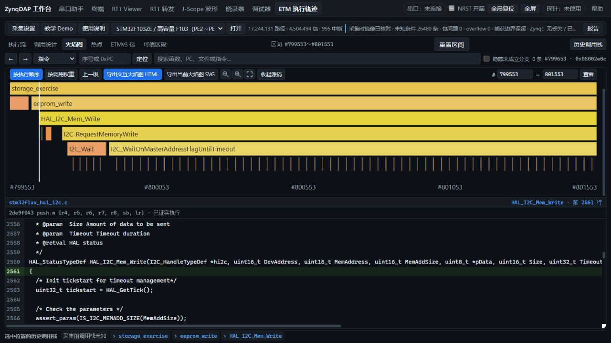

# main 合并后 F103ZE 真机验收与 HAL 存储 Trace

2026-11-03～04，Asia/Shanghai。起点main 41e2cee；首批修复/新例程提交ae9b774。本轮不推送、不写探针QSPI。所有结果均限定实际F103ZE及下列配对；不推广到未在线H743/HPM。

新HAL例程与旧CDC共同提供了实际输入。**本轮实际HAL记录的新旧完整60张表及182项查询一致**，普通Web按钮的断点合并回归已修复。8页主流程均已操作；不能宣称所有功能零问题：ZL-130原配对STOP尾包、ZL-131长暂停后的CDC、ZL-137混合变量标定仍有失败证据。最终固定EXE/新STAT配对收尾正在进行，下文明确分列其状态。

## 现场、身份和恢复

初始探针仅DAP30000021、PL未初始化；按既有JTAG/RAM流程恢复（ZL-060）。F103初始复位进ROM、无CDC；用户确认未通电，接独立电源/BOOT0=0并重新插拔后，COM34 CDC48运行、RCC_CFGR=51040a、CPU/HCLK48MHz、TRACECLK24MHz名义值。供电不足组保留（ZL-129）但排除正式性能比较。

| 实际加载配对 | bit SHA-256 | PS ELF SHA-256 | 验证范围 |
|---|---|---|---|
| hpm6800-usb-fixed-133-20261102 | 106d579bc1b79c2b873fd1e3eb2609d468892a67613d85a6e41d4dc90c8fc177 | e93f1810d48e77f8d9aa097f643e40e0aaee32bdec1c263c1428f092909e608a | 初始ARM SRAM/RTT/HSS；物理76420B匹配；无DDR ETM |
| fclk133-release-20261101 | af1031d3caa0d7bd3b6adffa911d26efdab9e0bfb5223fb18f70dabb70ebeeed | 2137f7d0f507c08574f36223130103c0710645cbfdefb5c1d8c8efb0cfb990a0 | HAL/CDC正式三轮ETM比较；旧PS不兼容当前Web RTT/HSS action10，ZL-087 |
| main-ddr-usb-133-20261104 | 同release bit | f4690b6917d795cf401a16673cea92fe6e2e76f84c7c6f2bd2e41a4a41fc14b5 | 当前源码统一PS；物理76124B匹配；CLI/Web DDR、RTT、HSS通过，保留STAT缺陷 |
| main-ddr-usb-133-statfix-20261104 | 同release bit | ef62ea8171ff7c2affefdcb718c0e2a2fa3cd5630a408b7a83faaf02d5dafc41 | STAT修复PS；物理75756B匹配；源Web混合实采/CSV/回放通过；最终冻结验收待收尾 |

后两套PS确实重新构建，输入/选项/SHA见各prebuilt manifest；bit复用已布线release，未修改RTL或新做PL实现。133.333MHz是约束，原WNS0.319ns/hold0.033ns。SWD10/50/60时实际FCLK约120/100/120MHz，逐轮物理MEM-AP0读回并计算，非外部频率计；未由主机暗改MCU PLL。

原内部Flash完整512KiB双读SHA `48f226217497607c696a156addbb363925577499b00ee64f187bd5eea7a94499`，有效段原已等于CDC48。HAL完成后已恢复并逐字节匹配完整原Flash。原Flash/SRAM/GPR/NOR/EEPROM字节仅私留build，不提交。最终板上状态见收尾证据，历史快照不代表当前状态。

## 8页功能及性能

使用实际浏览器和公开page describe/click/invoke，核对数据与状态。源码工作台、固定EXE普通按钮、captureNative辅助路径分列。投递成功不等于完成。源/固定版使用独立runtime/data，用户dist数据5文件更新前后SHA相同。

| 页面 | 实际通过范围与限制 |
|---|---|
| 串口助手 | PING/INFO，3×8192B逐字节回显、保存；长RAM测试后WinError31独立保留ZL-131 |
| 终端 | 实际COM34接收PONG和保存 |
| RTT Viewer | 上行3800B、下行31B精确，RAM/核心/时钟/运行状态恢复 |
| RTT转发 | SWD50/60各3轮，全部发布量=接收=moved，递增序列精确、读写错0；CLI/Web同2048B口径补测 |
| 烧录器 | ELF CLI/Web各3轮擦写、完整有效段校验、复位；HEX/BIN补测在最终收尾记录 |
| 调试器 | ELF/DWARF，16KiB SRAM三轮写读及恢复，R12往返恢复、真实单步、cdc_poll硬件断点PC08000590 |
| J-Scope | 1/8变量、多周期、RAW逐值/包序号/最终计数/STOP尾部；8种scalar、非对齐/跨1KiB、CSV逐值、缩放/无误触发、同文件回放；标定失败另列ZL-137 |
| ETM | CLI/普通Web真实1秒采集、起点/恢复、完整窗口/质量、六视图、导航、源码、八种导出与记录导入；CSV与CLI字节相等，导入summary/quality相等 |

### SRAM、串口、烧录与RTT

SRAM峰值512words/depth32/256blocks/3重复，另3秒soak；历史10/60秒soak不冒称本轮时长。MB/s均十进制。

| 项目 | 当前CLI中位 | 历史最佳或当前Web |
|---|---:|---|
| SRAM SWD50 读/写 | 4.0492 / 3.9806 MB/s | 历史Golden4.0498 / 3.9824，配对不同 |
| SRAM SWD60 读/写 | 4.8315 / 4.7385 MB/s | 历史Golden4.8348 / 4.7479 |
| RTT SWD50/60，1024B块 | 3.8816 / 4.6437 MB/s | 历史3.8832 / 4.6460；当前3秒、历史2秒 |
| 控制API SRAM10，16KiB读/写 | 0.6520 / 0.6413 MB/s | Web含HTTP/JSON0.1094 / 0.0604 |
| 8192B CDC往返有效吞吐 | 0.2270 MB/s | Web发送/接收检查/首屏0.0313；不是USB线速 |
| 约20KiB ELF烧录/校验/复位 | 1.450s | Web2.704s；计时边界近似而非同内部函数 |

初次RTT Web自动选2048B而CLI1024B，原首末活动段3.9795/4.7840不直接算严格提升。统一PS后补同2048B、delay255、生产3秒、各3轮、同首末非空活动段公式 `(total-firstChunk)/(lastTime-firstTime)`：SWD60 CLI中位4.7418、Web4.7764MB/s；约0.7%差异含主机调度。完整数据与尾部均校验。50MHz逐轮值见raw/unified-*-rtt/result.json。

### HSS接收回归与改进

同统一配对/静态RAM/60MHz/flags0xa1，CLI单u32 period48ticks为500kS/s，8u32 period197ticks为121827.4组/s，各三轮3秒稳态跳采0。启动可能跳1点，不能说整个会话任何时刻零跳采；8变量48ticks过载对照保留。

旧固定Web只有约90k/43k组每秒并额外跳采。原生EP87从逐512B同步读取改为65536B连续后台收取，4MiB有界队列溢出显式失败；只有本次调用之后的新USB空完成才可报告排空，不能把队列暂空当EOF。实测PyUSB/libusb部分超时保留已传字节，20项接收/代理单测通过。源Web单/8变量上述高速与1kHz各三轮（12窗口）稳态跳采0，逐值/序号/最终数量一致，停止/尾部通过。单次大块方案仍跳采的中间结果保留。ZL-123仅F103主机路径部分解决，未代替原HPM板复验。旧HPM配对F103停止19点缺尾ZL-130仍待定位，不能以换配对通过关闭。

## HAL SPI Flash / EEPROM例程

[源码及运行方法](../../../firmware/target/stm32f103_hal_storage/README.md)，[目标产物](../../../prebuilt/targets/f103ze-hal-storage-20261104/README.md)。HAL SPI2 PB12～15、1.5MHz；I2C1 PB6/7、100kHz、EEPROM0x50/8位地址/8B页；PE2～6保留Trace。CPU48MHz。实物JEDEC **EF4018、16MiB**；EEPROM应答只证明地址存在，不是独立芯片ID。

启动/100ms循环只读，命令2双读备份，命令3需有效备份及一次性arm 0x53545257。NOR末4KiB扇区0xFFF000，512B图样从偏移0xF0跨256B页；EEPROM从0xDB写29B跨8B页。写后逐字节检查，再恢复整个4KiB/256B并实际独立读回。原SHA分别 `ec49cab04f685666b5536a49d6a9e0ada6975ebb72087ebf8136b41668f2b49f` / `ba6b09b3804088cb4fc17bdee75f974356a1d9fa30d1c1f4b6e4b7685cdf38af`。

功能轮、CLI3、辅助Web3、源码窗口及普通固定Web3均核对外设恢复。另3次受控MCU软复位后backup_valid=0，主机重新提供原备份并恢复两区，实际SHA相同（ZL-138）。最后NVM核对在切回CDC之前；切回后未执行SPI/I2C写入。不能把RAM中的备份相同代替实际外设读回。

实际v3目标ELF SHA `dbaff7a388bb66fb2d1439f729f60c4f6620ff464c623bda80e2a3f7ef6a4d44`。固定ST HAL1.1.10 SPI/I2C补充源码、license/provenance纳入Git；全部构建输入见manifest。保留ZL-132初次向量链接失败、ZL-133 WFI边界，不把其失败产物标交付。

## ETM端到端性能及新旧算法

所有正式三轮ETM均release bit/PS2137、目标48MHz/Trace24、SWD10、硬件1秒。CDC新旧控制对照用同一Echo实现64B/2ms，每个完整硬件窗61～62次精确回显。

| 任务 | CLI三轮秒（中位） | 普通固定EXE Web按钮至首屏秒（中位） |
|---|---|---|
| CDC新C++ | 11.049 / 10.692 / 10.634（10.692） | 12.298 / 12.348 / 12.665（12.348） |
| CDC旧tag实际CLI重测 | 25.081 / 24.537 / 24.613（24.613） | 历史Web六轮中位32.734、冻结单次最佳29.173，跨历史窗口仅作参考 |
| HAL存储读写 | 9.962 / 9.812 / 9.777（9.812） | 11.344 / 10.834 / 10.685（10.834） |

CDC当前CLI较本机重测旧tag中位缩短56.6%，普通Web比CLI约15.5%；HAL约10.4%。CLI计入进程/连接，Web按钮不计之前连接/文件上传，不能把它们当同内部函数微基准。HAL Web外层全流程15.127/14.550/14.585秒另含连接/设置/清理；辅助captureNative10.875/10.798/10.755秒不冒充普通按钮。旧离线7.2秒/估算8.43秒不作为E2E。

旧参考tag archive/main-before-etm-cpp-20261103（06452f2），参考worktree未改。相同HAL CLI输入及最终普通Web输入分别验证：全函数/行区间/segments/Web ELF DTO一致；完整执行块、诊断、analysis、默认视图、语义meta、**60数组dtype/shape/每个值完全相同**；旧Golden真实生成库与new direct/binary/rescan/repeat四种路径一致；5种实际输入变更拒绝；**182个深度查询DTO一致**。最终Web实际store再与重建cpp全60表相等，含源码。限定这些实际输入，不宣称所有可能程序均正确。

最终普通Web记录约1724万路径，入口包含storage_exercise→eeprom_write→HAL_I2C_Mem_Write，源码/指令/火焰图可见。完整输入保存在[hal-storage-write-input](hal-storage-write-input/manifest.json)，PNG在下。六视图、六导航、八导出、导入完成证据见raw/hal-web-views-finish/result.json；原脚本在异步导入清理阶段过早切换的失败保留，纠正等待后通过。

## 修复、检查与未完成边界

- ZL-134：普通Web函数起点仍把NativeImage当pyelftools，报get_section_by_name。C++新增按$t/$d/$a映射的Thumb可断点边界；Python仅规格/DTO。三ELF所有边界、函数/行/地址及非法拒绝一致，HTTP同时禁Python ELF/Capstone。ae9b774后干净固定EXE bc624711实际HAL3+CDC3普通按钮通过。
- ZL-135：停止后DATA守卫阻断JSP回放；分离同步回放标志，保留迟到live守卫。原3231点全值回归及新源Web实采/回放通过。
- ZL-136：PS软件STAT复用槽残留；清零payload，新PS实际采样/回放usb错误0。原52719坏STAT保留，不由解析器掩盖。
- ZL-137：混合计划标定err=-4/完成0，10/60MHz失败；独立不标定实采通过，根因待定位。
- ZL-130原配对缺尾、ZL-131长RAM暂停CDC枚举但WinError31仍待定位。CDC已有CaptureEntry+UsbReconnect PA12短拉低/恢复流程，精确回显恢复不等于关闭根因。

检查：161模块语法、130 Web自测、60 CLI自测、20 HSS/代理专项、9生产C模型通过；共享驱动sync --check通过。原生断点13专项、3ELF静态及HAL完整差分另通过。[原生编译身份](raw/native-build-identity.json)保留实际41e2源码底及输入SHA，不能改写为后来报告提交编译。

[公开证据索引](raw/evidence-manifest.json)仅归档有界诊断与已知测试模式，不含运行令牌和私有备份。完整工作输出build/main-web-hardware-20261103/。最终固定EXE、新配对长窗、HEX/BIN及最后状态将追加在本报告收尾节。
