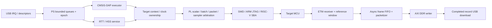

# Probe RTL / C 固件架构与鲁棒性审查

2026-11-02（Asia/Shanghai）。审查基线 `main@7ec002a`，被测生产RTL/C哈希见 [raw/results.json](raw/results.json)。起始工作区只有原有未跟踪 `build/`。审查期间另一工作提交 e360a24 调整ETM问题编号，生产RTL/C未变；本轮避让109/110并使用111～115。本轮不修改生产 RTL/C，不访问 USB/JTAG/板卡，不构建或替换 bit/ELF，不重新判定历史板测和板上身份。

结论：**PL 承担协议时序、批量传输和采样，PS 承担 USB、会话和调度，这个方向合理，值得保留。正常路径已有较好的验证基础；异常输入、失败恢复、长期运行与物理签核仍不足以支撑“任意工况下可靠”的结论。优先修边界和恢复，再做局部吞吐优化。** 本轮新增 ZL-111～115；没有证据将这些缺陷直接认定为 ZL-002/003/004/098 的根因。

## 1. 具体发现，按优先级排列

### ZL-111 / P1：DAP 缺少端到端请求长度与响应容量检查

- `firmware/xusbps_daplink_dma/dap_main.c:227-240` 只复制本次 request_length，调用 DAP 时不传该长度和响应容量；除顶层 0x8c 外没有通用预检。短包没有覆盖的 execute_request 尾部保留旧内容。
- `DAP/Source/DAP.c:1623-1766` 的 TransferBlock 在 count>1023 时进入分块回退，分块仅限制 DMA 临时数组，**没有限制整个 USB response**。`DAP.c:2252-2269` 的 ExecuteCommands 同样直接累加子响应、推进指针，无剩余容量参数。顶层特判也不保护嵌套 vendor 命令。
- 复现 A：真实 dap_main.c 先处理五字节 SWJ_Clock 10MHz，再收到一字节 0x11。mock DAP 消费端观察到旧 10000000 参数，入口没有拒绝。这里只证明旧参数被交给执行器，未在硬件上改时钟。
- 复现 B：原样提取生产 `DAP_SWD_TransferBlock` 函数，mock 成功 DMA，输入 1024 个 DP read，输出 **4100B**，覆盖名义 4096B 响应槽后的四字节哨兵 `78 56 34 12`。使用 4128B arena 安全观察越界，不故意破坏宿主进程；不是 ASan 全固件覆盖。真实 USB 槽紧邻其他槽，实际后果取决于队列位置。
- 影响：主机错误包、版本不匹配或损坏长度可导致旧参数被执行、越界读取/写入、其他在飞响应被破坏。默认主机正确分包不消除固件防线缺口。
- 建议：入口统一 checked executor，带 `request_length`/`response_capacity`；先完整验证复合命令的输入消耗与最大响应，再执行任何有副作用的操作。读块最多 `(capacity-4)/4`，写块还必须验证输入负载；子命令扣除外层头预算。不能靠 memset 或事后截断 response 修复已发生的副作用/越界。
- 证据：[dap_ingress.log](raw/dap_ingress.log)、[response_capacity.log](raw/boundary/response_capacity.log)。

### ZL-112 / P1：AP 上下文恢复失败仍被当作所有权已释放

- `probe_target.c:171-188` 调用 SELECT/CSW/TAR/SELECT 写入时忽略返回码，随后恢复本地 DAP/时钟并清 claimed/saved。函数是 void，`probe_stream.c:probe_before_dap` 无法阻止接着执行普通 DAP 命令。
- 复现：复用已有 production target C harness，正常 claim 并改变 TAR，在 release 前注入 FAULT。结果 claimed=false，但 TAR=`0x20000800`（应为 `0x20000040`），SELECT=0（应为 `0x01000010`）。
- 影响：上位调试器缓存的 AP 状态与目标实际状态分离；若下一条命令复用缓存、直接访问 DRW，可能访问错误地址。实际错误内存写未上板复现。
- 建议：release 返回完整结果，保留首次错误和恢复错误；恢复失败进入明确的 context-invalid 状态，拒绝依赖旧上下文的命令。恢复过程验证 posted AP 写完成，必要时读回可读寄存器；由受控重建恢复有效状态，不静默重放原目标写入。
- 证据：[restore_failure.log](raw/restore_failure.log)。与 ZL-002/003 的历史现象相关，但尚无因果闭环。

### ZL-115 / P1：标量/SWJ 等待缺少超时和 Abort 退出

- `DAP/Source/SW_DP.c:370-374` 的实际 `SWD_Transfer` 一直轮询 BUSY；`DAP/Include/DAP_config.h:378-380` 的 `swd_wait_idle` 也没有期限。`SW_DP.c:120` 的 SWJ 序列使用后者，JTAG glue 的 run 也复用标量传输。
- 复现：原样提取实际生效的 SWD_Transfer，MMIO mock 保持 BUSY=1，DAP_TransferAbort=1。宿主在 2 秒超时后终止该进程；没有函数返回。该注入证明持续 BUSY 的处理缺口，不证明正常 SWD FAULT 必然让 PL 卡住。
- 影响：USB IRQ 可能仍响应，但主循环无法进入 probe_poll/etm_poll，正常控制/停流不能前进；外部 EP0 engine reset 若可用可能救回，不等于本路径具备有界恢复。
- 建议：公共 MMIO wait 使用独立 PS 时间源，按最长合法事务和最低速档设置 deadline，检查取消/epoch；失败保存状态并确认软复位结果。批量路径的 2000000 次轮询和 sampler 的 1000000 次轮询也应改为明确时间预算。AXI 本身挂死与普通 BUSY 不退应区分，后者加软件超时不能修复前者。
- 证据：[scalar_busy.log](raw/boundary/scalar_busy.log)。

### ZL-113 / P2：QueueCommands 填满接收环后没有前进路径

- `dap_main.c:222-225` 只有找到非 0x7e 请求才开始消费排队命令；16 个槽全部是 0x7e 时直接 break，RX-ready 又因为满环返回 false。
- 复现：投递 16 个排队包，调用 handler 100 次，执行数始终 0、队列深度16、不能接收执行终止包。正常保留一个终止包槽位的主机流程不受本例影响；未声称现有 Web/OpenOCD 已触发。
- 建议：按 QueueCommands 协议定义队列满时的执行/拒绝行为和终止包通路，验证 15+Execute、16×Queue、reset/abort/短包及响应背压组合，避免“等结束标记”与“不给结束标记入队”互相等待。
- 证据：[dap_ingress.log](raw/dap_ingress.log)。

### ZL-114 / P2：SWD AXI 寄存器写入忽略 WSTRB

- `fpga/rtl/swd_controller.v:556-615` 多数 CSR 用完整 WDATA 覆盖，未检查字节使能；`start_req` / `packet_start_req` 也没有 strobe 限定。engine reset 和 sampler 一部分路径已有检查，行为不一致。
- 复现：真实 controller，PACKET_LEN 先置 `0x1234`，再以 `WSTRB=0` 写 `0x5678`，读回变成 `0x5678`。输入/握手都来自仿真，未在板上写 CSR。
- 影响：字节/半字写或零 strobe 事务可能改动无效字节、甚至触发控制动作。目前生产 Xil_Out32 全字路径不是该例触发条件。
- 建议：统一 CSR 写策略；数据寄存器按 strobe 合并，命令寄存器限定有效字节，或对不支持的窄写明确拒绝。测试独立 AW/W、R/B 背压、各 strobe、busy 时写配置及启动脉冲。
- 证据：[zero_strobe.log](raw/zero_strobe.log)。

## 2. 框架评价



**RTL 值得保留的结构：** SWD 单主时钟线性状态机；独立 JTAG shift/core；scalar/batch/packet/RTT/HSS 复用线协议后端；BRAM 数据与命令控制分离；posted-read 流水和 final drain；JTAG sticky-error fence 后才发布 HSS 包。ETM 录制与 USB 下载分离，独立参考计时、不可回压源丢帧计数、EOF/尾字节元数据、B 响应后提交字节数，能够避免把“主机收到了数据”误判为“硬件窗口完整”。

**C 值得保留的结构：** IRQ 大体负责有限的数据搬运，主循环承担业务；DAP 与流队列保留 USB DMA 生命周期所有权；epoch 丢弃旧会话结果；DMA cache line 对齐；DDR capture 区明确保留并设非缓存；目标内存访问按 1KiB AP TAR 边界分块；启动 capability/ID 检查；packet launch 后失败不自动回退重放写操作。这些都是可靠性的真实基础，不建议推倒重写。

**框架主要欠缺是跨模块契约没有统一：** 成功路径能组合，但状态失效、恢复失败、取消、USB reset 与 target context 的传播不一致。probe_stream.c 同时包含 USB、HID 协议、RTT、HSS、统计与调度；DAP.c 包含协议解析和平台加速路径；MMIO 地址/位定义分散；多处紧凑单行状态修改增加审查成本。建议分阶段抽出 request validator、USB queue、target session、RTL backend 和业务服务，保持接口兼容并以行为测试锁定，不进行一次性大重构。

## 3. 可靠性边界与待签核项

| 维度 | 本轮判断 | 依据与限制 |
|---|---|---|
| 常规 SWD/JTAG/RTT/HSS 数据链 | 已有较好基础 | 9组现有C harness、9个RTL顶层本轮通过；历史实板限定范围有效，不能泛化所有目标/频率 |
| 非法/截断/超大请求 | 有明确缺陷 | ZL-111，包括确定的响应越槽写入 |
| 异常后恢复与取消 | 不充分 | ZL-112/115；历史 ZL-002/003/004/098 仍未关闭 |
| 调试插入时采样时间语义 | 已知不足 | ZL-001；sampler_arm 重新设置计时，不能把数据完整与采样周期稳定等同 |
| 持续过载与背压 | 有机制但边界仍需加强 | 不可变bank、RdOff提交顺序已有测试；ZL-080 短包/fence开销仍存在，ZL-113 表明队列活性有缺口 |
| CDC / 外部 IO | 尚未完整签核 | ZL-007；本轮没有重新跑 routed STA/CDC 或测眼图 |
| 长期运行 / 电气余量 / 冷启动 | 本轮不能评级为全面通过 | 秒级板测/功能仿真不能给出MTBF、PVT或本次配对的冷启动保证 |

CDC 专项复核：`orbtrace_frame_async_fifo.v` 使用 Gray 指针及两级 ASYNC_REG，`orbtrace_ddr_capture.v` 对配置保持、toggle、snapshot settle 有明确安排；但被审查的 XDC/Tcl 没看到该 Gray 总线对应的显式 skew/max-delay 预算，时钟域以 asynchronous groups 切开。需要在**最终实现约束和路由网表**核对位间到达界限、CDC-1/7/10 等条目的实际拓扑和 reset release，确认例外优先级与约束覆盖，不能仅凭 Gray 编码/ASYNC_REG 或宽泛 false path 宣称签核。此项更新 ZL-007，不另立“已发生CDC丢数”问题，也不将当前源码缺少专项约束直接等同于某个既有bit违反要求。

另外，DDR writer 的 byte_limit 预算依赖上游 packetizer/模式发生器，writer 自身主要在 burst 边界守 REGION_END。当前固定区域集成测试通过，不能据此报成已经越界；若将模块做通用IP，应明确 assume/guarantee 并增加容量断言。AXI 永久不返回时不能简单丢弃已发事务，故应把“超时报告”与“事务隔离后安全复位”分开设计。

## 4. 优化顺序与验收目标

| 顺序 | 工作 | 预期收益 | 需要的验证 |
|---|---|---|---|
| 1 | ZL-111/112/115：边界校验、恢复结果、deadline | 防止错误命令/内存破坏/主循环停摆 | 畸形包、嵌套命令、注入FAULT/WAIT/BUSY、cancel/reset，先无副作用后执行 |
| 2 | ZL-113/114：队列前进与统一CSR写语义；完成ZL-007签核 | 降低跨功能和不同主机兼容风险 | 队列满/USB背压组合；AXI属性检查；真实路由CDC/IO预算 |
| 3 | 显式 target session/owner 状态机，事务预算化主循环 | 状态可解释，限制HID/停流响应延迟 | DAP持续洪泛时测最长控制延迟；每条错误路径检查状态不变量 |
| 4 | 原生批量内存能力贯通主机（既有 ZL-093） | 提高真实Web吞吐 | 固定配对/实际时钟/字节量的E2E；历史7.4倍差距不是本轮预测收益 |
| 5 | HSS整字打包、短包与fence成本优化（ZL-080） | 减少每包固定开销 | 每有效样本周期/包填充率/丢样和时间戳，保持fence与gap真实性 |
| 6 | 有证据后再增加FIFO弹性或DDR outstanding | 提高局部数据面利用率 | 首先测FIFO高水位、AW/W/B空洞；时序/资源及全窗口完整性 |

具体可优化点：

- `probe_stream_engine.v` CLEAR 每包清128个32位字，GATHER 每周期聚集一个字节；对对齐连续u32变量可增加整字直通，尾部无效区仍需确定填充，保留任意字节布局。收益必须实测，当前瓶颈可能在线协议和fence。
- `orbtrace_frame_async_fifo.v` 读端 fetch/read_wait/valid/pop 导致持续 ready 时约每3周期一帧。可加预取/弹性寄存器实现连续输出，但当前ETM速率不必然受此限制，先看水位和带宽。
- DDR writer 已有双bank、最多16拍、单 outstanding。增加 outstanding 会提升控制复杂度与故障清理成本，先做计数观测，不预设“更多并发一定更快”。
- `chry_dap_handle` 会持续清队列，应给每轮事务数/时间预算，让 probe_poll/etm_poll 有可测的服务上限；中断和缓存的现有所有权规则保留。
- C 继续适合作为这层裸机固件。换 C++/RTOS 本身不能解决这些缺陷；有界缓冲、显式状态、错误传播、硬件契约比语言迁移更优先。
- 测试层增加PS+PL连接的故障场景和性质检查。现有host mock部分使用不同于ARM的队列布局（1024B二维数组，对照生产CDC2048B stride），后续要覆盖生产布局/缓存对齐/IRQ交错；仅host C测试不能验证DMA缓存一致性。硬件复测仍需匹配新bit/ELF及原始证据。

## 5. 本轮验证、证据与复测

执行 [review_checks.py](review_checks.py) 与 [boundary_checks.py](boundary_checks.py)，只调用本机编译器/仿真器。前者隔离复用现有 `tools/test_probe_host.py` 的9组生产C模型；RTL覆盖 packet contract/AXI、stream DMA、sample pipe、ARM JTAG、RISC-V、DDR writer/controller/trace。DDR writer输出92项、DDR trace输出9项；不把这些项等同于独立硬件场景数量。编译日志无错误。

针对性复现：6个注入/边界场景归入5个问题（ZL-111含短包和响应容量两个场景）。REPRO代表**当前缺陷被成功观察到**，不是产品通过，更不是修复关闭。常规基线通过与异常场景失败并存。

```powershell
python -X utf8 docs/validation/probe-rtl-c-review-20261102/review_checks.py --out build/probe-review-new
python -X utf8 docs/validation/probe-rtl-c-review-20261102/boundary_checks.py --out build/probe-review-boundary-new
```

脚本要求输出目录不存在，Windows使用本机Clang/MinGW和Icarus。源码函数提取仅替换外部依赖；标量BUSY模型超时后子进程由subprocess终止。真实CM3 SoC、全部RISC-V采样相位、形式验证、重新综合/布线和实板压力不在本轮执行范围。

归档：原始输出和生产源码哈希在 [raw/results.json](raw/results.json)，补充边界结果在 [raw/boundary/results.json](raw/boundary/results.json)。问题状态同步 [项目问题跟踪列表](../../项目问题跟踪列表.md)。本轮只交付审查、复现驱动和证据；没有生产代码修复，没有新增可交付bit/ELF，未改变板上状态，未留下本任务后台进程。
