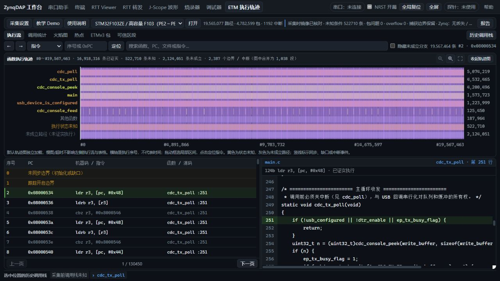

# ZL-111 / 112 / 115 探针边界与恢复修复验收

2026-11-04（Asia/Shanghai），基线main b066f1b。用户授权按顺序修复、真机验证并提交源码/实际bit/ELF。本轮三个问题在下述限定范围修复并关闭。未编程MCU Flash或探针QSPI，原有build保留。

## 修复结果

| 编号 | 实现与结论 |
|---|---|
| 111 | USB真实长度/响应容量贯穿checked executor；交接前先整包预检，复合命令全部验证后才开始执行。非法包返回FF，拒绝嵌套Execute/Queue；最大合法1023字读与1022字写保留。 |
| 112 | SELECT/CSW/TAR与posted完成均检查，CSW/TAR读回核对（仅忽略只读TRINPROG位）。失败保留快照/停止流/隔离普通访问；显式Connect才可验证恢复或重建AP基线，不重放旧目标写。 |
| 115 | 共用PS私有计时器等待，按实际FCLK/分频/事务规模给预算，检查Abort/epoch，记录首故障与复位结果。失败出口原子核对epoch/复位决定，开始前也验证出队epoch，避免旧请求借用新会话身份。 |

模型通过：50000边界输入、原4100B覆盖4096B案例、截断/累计响应/嵌套、真实USB入口的无交接拒绝和验证后重置窗口；恢复ACK失败/忽略TAR写/错CSW读；生产wait/标量/SWJ的BUSY、取消、epoch竞态、复位失败和低频预算。9生产C模型及60 CLI自测通过。实际有效SWD函数取编译生效体，未用旧#if0体冒充。

## 实际产物与身份

目录[prebuilt/probe-safety-111-112-115-20261104](../../../prebuilt/probe-safety-111-112-115-20261104/README.md)。正式application.elf与诊断validation.elf均实际重建。bit复用已有133.333MHz（7.5ns）release布线字节，未修改RTL/未新做PL实现；原WNS0.319ns/hold0.033ns仅为该复用bit的既有结果。

| 文件 | SHA-256 |
|---|---|
| probe.bit | af1031d3caa0d7bd3b6adffa911d26efdab9e0bfb5223fb18f70dabb70ebeeed |
| application.elf（正式） | d70c8df96b3fa79bbd6881a3499014e588af902cde6d8e823d7fcfbc7f8a8c42 |
| validation.elf（诊断） | 6fac6cd9498fe86ee99b6a07e3a7ef64dec370b8b338d7c1c4661e8e6e77b7fb |

构建参数/输入SHA/BSP见各build manifest，编译基线b066f1b+实际工作区输入，未伪装成当时干净提交。正式镜像无一次性注入控制变量，诊断镜像仅经物理MEM-AP0启用；诊断区在保留的39000000 MiB并明确非缓存。每次加载独立核对OCM，最后正式执行段81324字节完全相同。

用户中途确认板卡断电并重新连接；重新检查无DAP业务USB、JTAG启动未初始化（BOOT_MODE0、LVL_SHFTR0），再显式RAM加载/独立核对，没有沿用断电前“板上状态”。目标原Flash两读SHA48f22621…保留，原字节私存build。

## 真机故障与合法边界

正式镜像真实USB接口：13种非法/截断/累计越界/嵌套请求逐项返回FF，TAR与整个4KiB测试SRAM不变。其中复合请求的第一项为有效目标写、后项非法，仍整体不执行；合法最大读4096B响应、最大写4093B请求逐值验证。

诊断镜像：恢复写入阶段2/3各三轮，失败flags保留claimed/saved/invalid，后续缓存读写拒绝；显式Connect后原CSW/TAR与完整SRAM核对一致。标量读超时、SWJ超时、Abort和真实EP0 USB会话epoch切换各三轮；超时条件40ms，实际约40ms返回错误，旧epoch不发布响应，恢复后CPUID正确。Abort总responseSeconds含MEM-AP物理观测启动时间，不能把它直接当取消延迟；脚本独立断言发Abort到线程返回<400ms。

另外三轮受控SRAM写超时：目标可能已完成写入，固件仍返回错误；仅首字改变一次、相邻字未改，明确没有自动重放。数据随后恢复，整个RAM夹具再次恢复/核对。

这些是实际Zynq CPU、计时器、USB和MCU通路中的受控PS故障观察/失败分支注入；不冒充电气FAULT、物理AXI挂死或PVT测试。JTAG共用标量等待有生产函数模型与实板正常回归，未单独强制JTAG电气BUSY。软件无法保证从AXI读取本身永久不返回中恢复。

首轮真实epoch测试发现检查epoch与Abort之间的IRQ窗口，旧错误分类可触发多余复位；旧ELF/源片段/失败保留。修复失败出口临界区并增加确定性模型后，上述epoch三轮全部正确分类且旧响应被丢弃。开始前的epoch守卫另由真实USB入口模型覆盖。没有把重载恢复当修复。

## 正式镜像正常业务回归

| 范围 | 结果 |
|---|---|
| SRAM | SWD/JTAG×1/10/50/60MHz，共8条件，顺序/流水读写各三重复，逐值、跨页与恢复通过 |
| RTT | SWD10/50/60MHz×1024B×三轮2秒，所有递增序列及最终发布/接收一致，错误0；60MHz探针窗口中位4.6415MB/s |
| HSS | 1/8变量×1k/50k×三轮，RAW每值/包序号/最终计数通过；不外推临界高频稳定性 |
| 流中调试 | SWD/JTAG×50/60MHz×RTT/HSS8/HSS1，共12条件；704轮burst、16192条burst内DAP请求、36轮halt/step/resume，均继续前进、数据及最终量匹配；HSS节奏旧问题001仍保留 |
| 固定Web | 16KiB SRAM/寄存器往返、单步/硬断点、RTT上下行3800/31B；HSS单/8变量1k及8变量50k；RTT转发50/60各一个2秒窗口，全部字节与尾量一致 |
| ETM | CLI一个1秒、固定Web两个不同函数起点各1秒，完整硬件窗口、CDC实际回显、下载/解码/首屏、入口恢复与质量检查通过；包错0不等于全部执行可信，未知/边界保留 |

沿用已安装固定EXE SHA1ae6ed71abac01386db708e09e3cb0bc99f5149e388882bed3a58906be2612d7（源提交02d43aecdd7a8ff4496625a639594e04f8751959）；本轮没有改主机生产代码或更新用户data。工具新增--pair-dir以记录实际候选配对，并在交接测试前独立核对OCM，不再借用历史release标签。

## 恢复、限制与证据

所有RAM夹具有独立原字节、架构核心寄存器与目标时钟/运行状态核对；JTAG夹具恢复AFIO/APB2。Web调试清除了本轮临时断点，Trace入口/Trace配置按自身快照恢复；本任务未独立保存开始前的完整FPB镜像，不额外宣称全面FPB前后逐项相等。

测试器初版误按1KiB回绕比较F103最大块读，按实际TAR读回修正后合法边界通过。WinUSB同值SET_CONFIGURATION未实际推进队列epoch；真正测试采用既有EP0恢复并按契约clear-halt同步主机toggle。一次清理因STOP=-4未完成，已保留现场；同一镜像、不重载/不复位目标，经EP0/显式Connect后完整SRAM/GPR/RCC/运行恢复通过。初始编译/模型夹具错误亦保留。

长RAM测试后CDC配置出现WinError995，关联旧ZL-131现象保留（不证明与31同根因）；既有入口/PA12流程恢复后8192B及CLI/Web真实CDC Trace通过，不以此关闭131。没有顺带关闭002/003/001/070/140/141等其他问题。

最后完整512KiB MCU Flash与本轮最初备份逐字节相同，SHA48f226217497607c696a156addbb363925577499b00ee64f187bd5eea7a94499；CDC48运行、RCC_CFGR51040a。实际正式PS为d70c8d…、bit af1031…，物理代码81324B匹配；SWD约10MHz、FCLK约120MHz（寄存器计算，非外部频率计），RTT/HSS/DDR/DMA空闲。正常镜像最终wait/context恢复失败计数均0。

未写MCU Flash/QSPI，未验证新配对QSPI冷启动，不替代Golden；未新增H743/HPM真机验收。本任务EXE16852及其C++查询子进程已结束，共享hw_server12596保留。公开证据见[raw/manifest.json](raw/manifest.json)，原始Flash/SRAM/GPR与令牌不入Git。完整工作输出build/probe-safety-111-112-115-20261104。

## 再次断电后的收尾补验（本地21:11–21:16）

用户再次确认断电并接线。最初USB/CDC/JTAG均空，接线后COM34和Zynq JTAG出现；物理读取BOOT_MODE0、LVL_SHFTR0、FPGA_RST01F33F0F，确认是未初始化启动现场，未把断电前配对当作当前身份。重新RAM加载相同正式bit/ELF并在补验前后独立核对81324B执行代码一致。正式镜像15项边界测试再次通过，夹具完整SRAM/核心寄存器/时钟/运行状态恢复，CDC8192B完全一致；完整512KiB Flash仍与最初备份字节相同。

最新状态以[resume-power-final/final-state.json](raw/resume-power-final/final-state.json)为准：CDC48运行、RCC_CFGR51040a，SWD约10MHz/FCLK约120MHz（寄存器推算），RTT/HSS/DDR/DMA空闲，wait和context恢复失败均0。这里的补验不是重新进行全部高频/故障矩阵，也不是QSPI冷启动验收；前述完整矩阵保留为断电前实测。共享hw_server12596在继续时已不存在；本轮确认3121无监听后由现有入口启动hw_server18092并保留，未结束其他会话服务。没有本任务Web/采集进程遗留。补跑60 CLI测试通过，869项依赖哈希检查通过。
