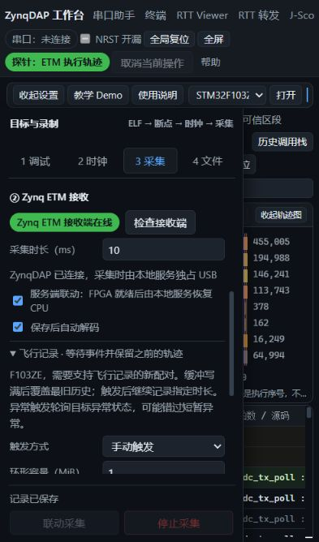

# 统一探针控制与 ETM 飞行记录验收

2026-11-05（Asia/Shanghai），开发基线 `f466935`，分支 `codex/session-flight-recorder`。统一控制服务和F103ZE飞行记录已经实现并完成下列源码/实板检查；固定EXE交付验收仍在进行。本次没有写目标Flash、探针QSPI或修改目标PLL/AHB/APB。

## 实现与产品边界

主机服务统一管理控制队列、USB/HID资源、会话epoch、取消和错误隔离，持续接收线程不进入控制队列。原生CLI和服务共享OS文件锁，避免不同进程抢占；文件锁放在共同LOCALAPPDATA目录，不受冻结程序独立TEMP影响。Web/服务CLI的批量ARM内存操作复用同一实现，保持1KiB TAR边界、已确认CSW、posted完成屏障和非对齐边界字节，失败不自动重放写入。浏览器启动不再自动打开HID占用探针。

ETM采集租约保留到原页面完成目标寄存器/断点恢复，只允许原owner接回USB。其他客户端不能利用采集完成与页面恢复之间的间隙抢占；恢复未确认时保留失败状态。纯服务原生capture仍由其板测事务保存/恢复现场。`toolbox.py --runtime R probe status/cancel/call`无需浏览器worker；`call`使用公开USB/HID/串口动作以及打开时返回的owner/resourceEpoch，不静默重试硬件操作。

固件将Connect/Disconnect/SWJ及明确复位/链配置作为流终止事务：主循环有界等待最多250ms排空旧流，再执行原请求。普通内存调试继续支持暂停/恢复；普通JTAG_Sequence不因命令号被误当成完整重连。HSS恢复保留名义采样网格，错过的周期计为跳采。满16个Queue且没有结束包时整批拒绝、无目标副作用，保留15个Queue+结束包的正常语义。队列规则依据[CMSIS-DAP QueueCommands](https://arm-software.github.io/CMSIS_5/DAP/html/group__DAP__QueueCommands__gr.html)。

HID `0.6-nonce32`在协商后关联请求/回复，拒绝同命令号的旧STATUS冒充新START。该防线不证明历史ZL-140必由旧ACK导致，原问题继续保留。ZL-003历史异常后的残留配置也没有凭新正常回归被关闭。

飞行记录新增环形DDR写入、64位累计字节/参考计时、触发后硬件窗口和按时间顺序下载。最多100MiB，保留段从完整formatter帧开始；物理覆盖、为帧对齐丢弃的旧片段、解码起点未知分别记录。覆盖旧历史不伪装成FIFO丢帧，也不把包错误0视为全部执行已知。普通有限窗口协议继续兼容。

本版飞行记录实板范围为F103ZE/ETMv3、CPU48MHz/TRACECLK24MHz、SWD10MHz；H743保留原普通窗口路径，飞行模式明确拒绝未经验证的目标。支持手动触发和主机轮询ICSR的Fault触发，以及CLI延时触发测试。Fault轮询请求间隔10ms，可能错过短暂异常，不是物理GPIO触发；不是持续传输/实时全量分析或任意时刻变量回溯。环容量按字节限定，触发后数据过多仍会覆盖更早的历史。

## 实际配对与时序

交付候选位于[prebuilt/session-flight-recorder-20261105](../../../prebuilt/session-flight-recorder-20261105/README.md)。原Golden/QSPI恢复包保留。构建时源码为`f466935`加实际工作区输入，不伪装为干净源码构建；PS/RTL输入指纹保留。

| 项目 | 值 |
|---|---|
| 最终bit SHA256 | c1ecef1c9983b99f96d6f073ea1b14cd890ff77406b28db57b5b2994a1ee7110 |
| 最终PS ELF SHA256 | 8d8e3d7372a57c642c070c451d17d61779baa5d5e9baa20fcd3691716846bfbe |
| 实现约束 | 133.333333MHz，7.5ns，RAW4+DDR |
| 最终setup / hold | 0.153ns / 0.032ns |
| SWCLK输出预算 | 7ns，实际6.800ns，slack0.200ns |
| 最终OCM物理核对 | 85652字节执行段完全一致 |
| 运行时典型Trace控制时钟 | FCLK约120MHz、SWCLK约10MHz；来自寄存器读回推算 |

首次完整实现内部STA虽为正，但7ns输出约束钩子缺失，校验拒绝出bit；实际未约束输出延时8.181ns。策略设置后重新安装钩子，fresh重实现通过；ZL-147限定关闭此构建问题。没有放宽预算、退回120MHz约束或加载失败产物。完整IO/CDC/PVT签核旧边界ZL-007仍保留。[时序](raw/verified_clock.json)、[输出路径](raw/swclk_launch.rpt)、[最初失败](raw/initial-swclk-unconstrained.rpt)。

## 实板证据

| 检查 | 结果与范围 |
|---|---|
| 初始身份与备份 | 原d70c8d安全ELF物理81324字节一致；完整512KiB目标Flash两读一致；FPB40字节独立保存 |
| 服务会话切换 | 早期e0cdc6 PS完成1000次重开与1000次旧epoch写拒绝；原SRAM、GPR、时钟、运行恢复通过 |
| 队列满保护 | 最终8d8e3d PS真实16包全部FF拒绝，64B原SRAM不变，随后合法访问正常 |
| HSS调试交接 | 最终配对SWD10/50/60、8u32/1kHz，每档100次CPUID/200次DAP交接；逐值和最终量一致，跳采149/17/140与时间线完全对应，周期保持整数网格 |
| 流中完整重连 | b77d93 PS RTT50/60各3轮全部序列/总量精确；最终8d8e3d各1轮再验通过。旧流先结束，重连后重新启动，无重载/重刷 |
| RTT正常回归 | b77d93 PS，10/50/60MHz，1024B块、各3轮2秒，所有发布字节均接收、序列精确。探针计数窗口中位0.798/3.878/4.639MB/s，不与2048B历史值混作退化对照 |
| 环形USB对物理DDR | e0cdc6 PS，1MiB环回卷，1048570B（含10字节尾帧）USB与物理MEM-AP0按相同逻辑顺序读取的SHA完全一致 |
| 长窗口参考计时 | b77d93 PS等待25秒，累计485016810B，保留1048570B；硬件5003312928拍跨32位计时，触发后2000000拍准确，解码992894条，包错0，初始gap/未知条件保留 |
| 真实Fault触发 | 最终8d8e3d PS临时RAM UDF进入HardFault，ICSR轮询触发后准确4000000参考拍（20ms）；通过异常返回退出夹具，VTOR/CFSR/HFSR/SHCSR与SRAM/GPR/时钟/运行恢复通过 |
| 普通窗口回归 | 最终配对100ms普通CLI窗口、下载、解码通过，原协议保持可用 |
| 源码Web | 普通页面飞行按钮手动触发、停止，以及恢复交接保护通过；其他owner在采集中开USB被拒绝。记录可浏览执行流，未知起点保留 |

上述各组按原实际PS区分，中间配对保存在prebuilt子目录，不把旧版本测试改写为最终版本重测。主要证据：[最终板控](raw/board-control.json)、[RTT重连](raw/rtt-reconnect.json)、[Fault](raw/fault-trigger.json)、[Web](raw/web-handoff.json)、[25秒记录](raw/flight-counter-wrap.json)、[可重解输入](raw/ring-input/README.md)。

SWD10MHz/16KiB，同配对服务初测读约27ms、直接CLI约25ms；写30–54ms仍有波动。早期与Vivado并行的测量也保留，不能用其作为稳定性能结论。本轮不写目标Flash，未给出新的烧录E2E改善结论；ZL-141只算部分解决。

## 离线检查与失败保留

130项Web、60项CLI、161模块语法、10份共享驱动同步通过。新增控制队列4项、跨进程所有权2项、HID关联3项、内存事务3项、DDR主机8项；生产C与50000边界输入检查通过。RAW4集成保留原9场景并增加五次回卷/部分尾帧/准确后窗，writer原92场景通过，HSS新增恢复网格仿真通过。

失败不删除：首轮Vivado缺临时父目录；首个新项目遗漏DDR开关后主动停止；首次新环形仿真期望误算645 mod128，修正测试预期为5；首次服务测试器把超时当空字节导致排空循环不退出，经关闭本任务句柄进入finally完整恢复后修正；Web夹具先关entry再改已禁用reset控件的顺序失败，修正顺序后通过；CLI离线回放夹具与真实板测并行时抢占OS锁被拒绝，补充对外部所有权边界的mock，没有放宽生产锁；1秒手动等待被无关默认延时参数拒绝的问题已修正，冻结验收继续覆盖。

## 使用

Web：载入匹配ELF并连接F103ZE，核对CPU/TRACECLK，进入“3采集”→“飞行记录”。选择环容量、触发后时长、等待时限和触发方式。手动模式开始后点“立即触发”；停止会终止本次等待并恢复现场，不伪造已触发的完整记录。飞行模式不会沿用普通窗口的“先复位至断点”动作。

CLI示例（先独立确认已加载本报告配对且探针空闲）：

```powershell
python -X utf8 toolbox.py trace capture --elf prebuilt/golden/f103ze-cdc48.elf --bit prebuilt/session-flight-recorder-20261105/probe.bit --zynq-elf prebuilt/session-flight-recorder-20261105/application.elf --out build/my-flight --flight --ring-bytes 8388608 --seconds 0.02 --trigger manual --arm-timeout 60 --swd-khz 10000
# 在另一终端请求触发；--cancel则请求停止。返回requested不等于采集完成。
python -X utf8 toolbox.py trace trigger --record build/my-flight
```

当前源码界面截图：



## 交付状态

固定EXE构建与实板回归、最终整板恢复核对尚未完成。未进行H743/HPM新配对实板、QSPI冷启动、8小时压力或GPIO物理触发验收。历史003/140和烧录性能等未因此关闭。所有公开证据文件的SHA见[manifest](raw/manifest.json)；原Flash/SRAM/GPR备份、运行令牌留在本机build，不纳入Git。

## 冻结候选与收尾补充

1.1.0冻结包源5be7176、sourceDirty=false，EXE SHA290b10c5187fa6fca46487278433fb703d5eef971867ccaaf5463393d517edf1。普通冻结Web手动/页内取消/统一服务取消/1秒未触发超时四场景通过，恢复后资源为空；真实Web16KiB读写及完整现场恢复通过，中位读约0.108、写约0.124MB/s（含页面CLI投递与写后校验），不是服务内部27ms数据。冻结HSS8种标量、非对齐/跨1KiB、3268点全部RAW/CSV及回放精确；最终配对冻结服务另完成1000次重开/1000次旧epoch写拒绝，恢复通过。证据见raw/frozen-*.json。

收尾补正：ZL-148通过限定路径Git属性保留实际元数据/证据字节，未改bit/ELF；ZL-149补充Trace地址设置ACK检查，源码真实失败回复验证已通过，最终1.1.1包重新构建/正常实板回归中。原1.1.0成功证据不改写为1.1.1重测。
